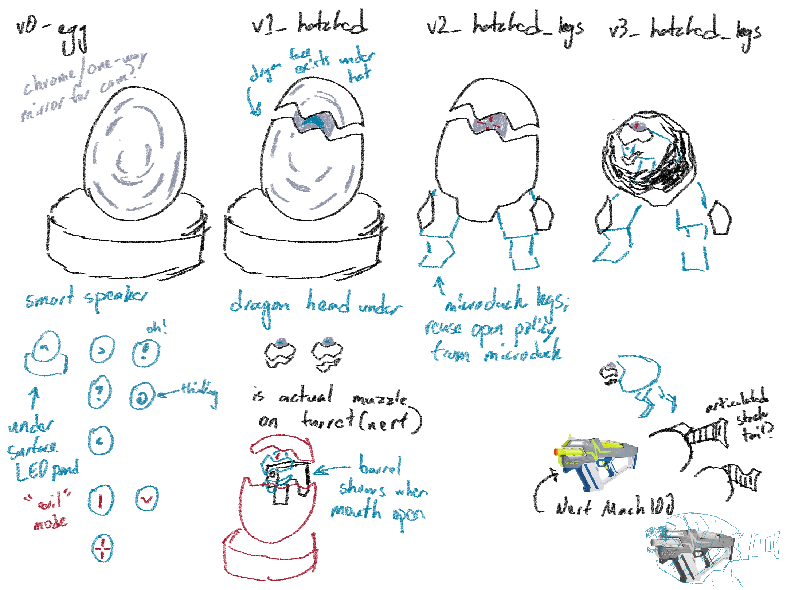

# Dragun Embodiment - I am very serious

Dragun's intended character across physical prototypes. Each stage can be a new build; the hardware does not have to transform or carry over.

## Organization

`prototypes/` contains a directory for each physical design. Each prototype owns its mechanical design, electrical design, bill of materials, and validation records. Shared components can be organized separately if actual reuse calls for it.

- [Egg](prototypes/egg/README.md) — the first prototype.
- A later, slightly hatched prototype is intended to have space for a small turret mechanism. Subsequent concepts include legs and a more developed dragon form.
